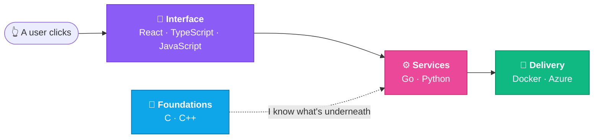
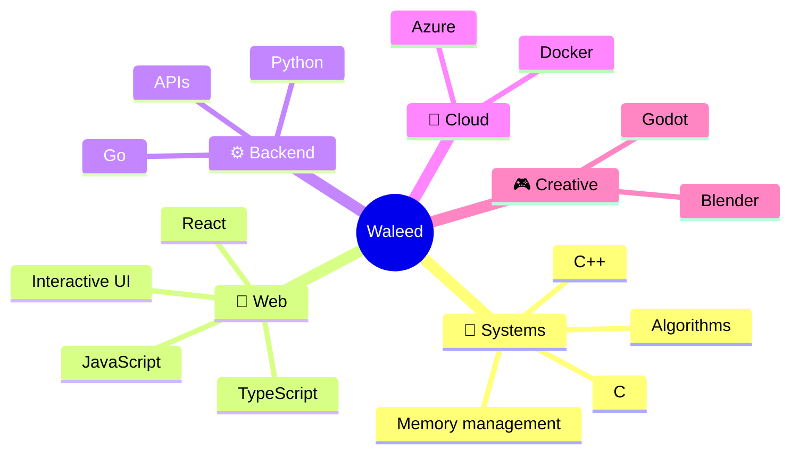
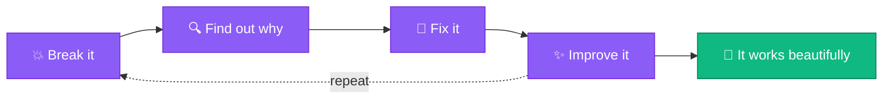

 

 

## 🌍 One click, the whole journey

I enjoy working across the full stack: clean, interactive interfaces on top, practical and reliable software underneath. I can follow a click all the way down, and all the way out to production.

 

## 🧰 My toolbox, by layer

<table align="center">
  <tr>
    <td align="center" width="20%"><h3>🎨 Interface</h3> Interfaces that feel good to use</td>
    <td align="center" width="20%"><h3>⚙️ Services</h3> Practical, reliable backends</td>
    <td align="center" width="20%"><h3>🧱 Foundations</h3> Know what the machine is doing</td>
    <td align="center" width="20%"><h3>🚀 Delivery</h3> Containerized and shipped</td>
    <td align="center" width="20%"><h3>🎮 Creative</h3> Games and 3D, where polish counts</td>
  </tr>
</table>

 

## 🧠 What I've learned

 

## 🔁 How I learn

Graduate of **42 Helsinki**, where there are no shortcuts: you learn by building, breaking and fixing, with other people.

 

## 📊 GitHub stats

